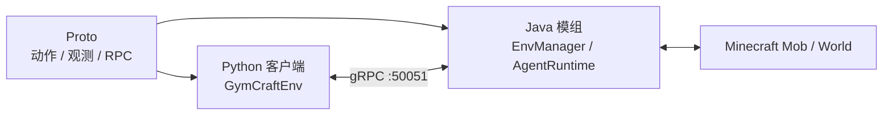

# GymCraft 开发文档

本文档收录根 README 中省略的实现细节，供环境、动作、观测和 Python 客户端开发使用。

## 运行架构

GymCraft 由共享 protobuf、Java 服务端模组和 Python 客户端组成：



`GymCraftRpcServer` 随服务端启动。`GymEnvService.Connect` 根据实体 UUID 查找
`EnvManager` 中已经存在的环境并建立独占会话，不负责创建环境。

一次 step 的主要流程如下：

1. Python 将动作组件打包为 `ProtoMcAction` 并通过 gRPC 提交。
2. `AgentRuntime` 将请求排队，等待受控实体的 tick。
3. entity tick 前执行动作并应用 Controller/环境级 AI 控制策略。
4. entity tick 后收集 `ProtoMcObservation`，计算奖励和终止状态。
5. gRPC 返回 Gymnasium 五元组所需的数据。

## 代码结构

```text
src/main/
├── java/io/github/mousemeya/gymcraft/
│   ├── gym/action/         动作调度器与组件 Controller
│   ├── gym/observation/    观测组合器与组件 Creator
│   ├── gym/component/      动作与观测共用的默认区域初始化契约
│   ├── gym/env/            McEnv、环境实现与实体快照
│   ├── gym/runtime/        AgentRuntime tick 调度
│   ├── gym/rpc/            gRPC 服务与会话
│   ├── gym/attachment/     通用 Mob 附件描述器、独立访问 API 与 env 访问作用域
│   ├── gym/fakeplayer/     FakePlayer 执行者、状态同步、库存桥接与事务
│   ├── gym/menu/           逻辑菜单会话与菜单适配器（session/ 会话与槽位、bridge/ self 菜单、adapter/ 按钮适配）
│   ├── gym/inventory/      Agent 统一物品栏布局
│   └── registry/           动作、观测、环境自定义注册表
├── proto/                  protobuf 与 GymEnvService 定义
└── python/                 uv 管理的 Python 客户端、demo 与调试脚本
```

核心类：

| 类 | 职责 |
|---|---|
| `EnvManager` | 按实体 UUID 管理环境生命周期 |
| `AbstractMcEnv` | 实现通用 reset/step、奖励与终止扩展点 |
| `AgentRuntime` | 在服务端 tick 中执行动作、维持策略并生成观测 |
| `ActionDispatcher` | 校验和分发 protobuf 动作组件 |
| `ObservationComposer` | 聚合环境启用的观测组件 |
| `EntitySnapshot` | reset 时重建相同 UUID 的受控 Mob |
| `MobAttachmentService` | 在无 env/Agent 依赖下附加、读取和移除类型安全的 Mob 附件 |

### Mob 附件与专属背包

持久附件由 `MobAttachmentSpec<T>` 描述，并统一通过 `MobAttachmentService` 访问。
环境构造函数传入允许访问的描述器集合；访问作用域只控制 Agent 可见性，关闭环境不会删除附件数据。
reset 会在初始快照前附加所声明的数据，并在实体还原后重新激活访问作用域。

`MobAttachments.AGENT_BACKPACK` 是首个通用附件：没有原生容器的 Mob 可获得 27 格持久背包。
`simple_mob` 启用该描述器，普通 Mob 的统一物品栏因此为装备槽 `0..7` 加背包槽 `8..34`；
`parkour_mob` 不启用，即使 Mob 已有背包也不会向动作或观测暴露。村民、马等继续使用原生容器。
背包随实体 NBT 保存，死亡时进入正常掉落；环境 reset 恢复创建环境时的快照。

## 注册表与组件

新增类型必须注册到相应入口：

- 动作：`ActionComponents`
- 观测：`ObservationCreators`
- 环境：`EnvFactories`

### 动作组件

| 注册 ID | 说明 |
|---|---|
| `gymcraft:step_move` | 单 tick 前进、横移、视角和跳跃控制 |
| `gymcraft:look_at` | 将当前视线对准实体、掉落物或方块 |
| `gymcraft:use_item` | 按 Agent 槽号向方块、实体或自身使用物品；食物药水等待消费完成，详见[使用物品动作](../use-item-action.md) |
| `gymcraft:move_to` | 使用寻路移动到目标坐标，按 Mob 中心的水平距离精确判定 `stop_distance` |
| `gymcraft:swim_to` | 参数与判定同 `move_to`，但使用两栖寻路（原版海龟同款）：水中、深水起点或目标在彼岸时仍可规划路径，陆地等价 `move_to`；动作期间临时换用三维游泳移动控制（海豚/青蛙同款，结束自动恢复），不切换游泳姿态。深水垂直岸沿（无坡度直壁）爬升能力有限，优先经岸坡/台阶出水 |
| `gymcraft:set_attack_target` | 设置实体攻击目标 |
| `gymcraft:attack_once` | 执行一次近战攻击 |
| `gymcraft:noop` | 空操作 |
| `gymcraft:jump` | 提交一次跳跃意图 |
| `gymcraft:break_block` | 必须指定工具槽位 `slot_id`；执行时该槽与主手交换（交换而非移动），通过 FakePlayer 复用原版方块破坏逻辑，结束后工具留在主手；空槽等价空手 |
| `gymcraft:set_block` | 校验距离和实体碰撞后放置方块；物品栏任一槽位有匹配方块物品即可，放置前自动换到主手 |
| `gymcraft:update_interesting_blocks` | 原子地批量添加或移除 Agent 感兴趣的方块类型 |
| `gymcraft:send_chat` | 以受控 Mob 的显示名称向全服聊天栏发送纯文本消息；正文最长 256 个 UTF-16 单元 |
| `gymcraft:open_menu` | 打开方块、实体或自身逻辑菜单 |
| `gymcraft:close_menu` | 关闭逻辑菜单会话 |
| `gymcraft:move_menu_item` | 在逻辑菜单槽位之间移动物品 |
| `gymcraft:click_menu_button` | 操作已适配菜单的按钮 |

`move_to` 和 `swim_to` 将请求所在方块归一化为可站立中心：X/Z 向下取整后加 0.5，Y 向下取整。
请求坐标和实际导航目标均须满足当前空间，因此单点空间需要包含该中心。
`move_to` 与 `pick_up_item` 在路径被清除、替换或卡住时最多自动重规划 3 次；终态的 `action_state.details`
包含 `navigation_reason`、`repath_attempts`、`path_owned`、`path_can_reach`、当前水平距离与最后路径终点，可用于区分不可达、外部清路和无进展。

### 动作与观测共用的区域初始化接口

`gym/component/EnvironmentRegionAware` 只有 `initializeDefaultRegion(@Nullable BoundingBox region)`
一个方法。环境在基线构建完成、运行时启动前，由 `ActionDispatcher` 和 `ObservationComposer`
向实现该接口的组件传入区域。组件仍继承原通用基类，自行设置默认边界并执行目标检查；接口和两侧组合器均不解释
具体组件的目标或过滤规则。区域注入先于具体环境构造函数中的配置，不记录初始化或显式
覆盖标记。通用基类通过 `SpaceUtils.validateSpaceStructure` 递归比较默认结构的字段、类型
和 Box 维度；边界与序列长度可以改变。`DictSpace.containsFields` 仅验证实际分支提供的字段。

`move_to`、`swim_to`、`look_at`、`set_block`、`break_block`、`pick_up_item`、`attack_once`、
`set_attack_target`、`open_menu` 和 `use_item` 的默认坐标边界来自 `baseline.region()`，
与区域捕获开关无关。放置/破坏使用整数方块闭区间，其他组件覆盖完整区域方块体积；
工具界面和命令通过 `AttachScope.around` 保留所设区域，即使两个捕获开关都关闭也可只圈活动
范围而不管理世界快照；只有六方向延伸距离全非正时工厂才返回 `AGENT_ONLY`。界面的默认
垂直范围为完整建筑高度，因此水平全零、双关仍产生一列有效区域。
没有区域时保留原动作空间。区域只用于初始化，运行时以组件当前 space 为准：
初始化后显式 `setSpace` 可收窄或放宽边界，移动、reset 和实体替换均不会重新初始化。
同一区域重复初始化得到相同边界；初始化函数不保护之前手动设置的坐标。暂不支持动作
执行期间修改范围，配置应在动作开始前完成。

实体动作的空间 JSON 包含服务端派生的 `x/y/z`，客户端仍仅发送实体 ID 或 UUID，protobuf
与 DSL 命令保持原样。实体以其位置原点判断是否落界内，包围盒相交不能放行；UUID 目标必须与
Agent 在同一维度。oneof 分支仅验证实际参数，自身菜单、自身物品使用和清除目标均跳过坐标校验。
`attack_once` 未指定 ID 时会校验当前攻击目标。ID 与 UUID 同时提供时，锁定目标优先采用 ID。

组件在 `apply` 中独立复核目标，越界在切槽、消耗、世界交互或导航启动前返回 `FAILED`，
导航以 `contains` 检查原始 protobuf 坐标和停止距离，内部修正到方块中心后不再校验
该修正位置。实体目标越界描述为 `target outside action space`，details 提供目标和三轴
low/high。拾取与锁定目标在 `tick` 复核实体当前位置；实体出界后立即失败并清理自有导航
或仍由本动作持有的目标。静态导航和挖掘不为运行中的范围修改增加复核逻辑。原有交互距离、视线和寻路能力检查仍生效，边界只约束目标，完整轨迹和原版间接
影响不受此接口限制；`step_move`、`jump` 等未实现接口的组件保持原行为。

动作空间可保留其他参数，仅更新绝对坐标：

```java
var pickup = actionComponent(ActionComponents.PICK_UP_ITEM.get());
// 实体位置覆盖最后一个方块的完整体积；客户端仍只发送 entity_id。
pickup.setSpace(CoordinateSpaces.withRegion(
    pickup.space(), new BoundingBox(100, 64, -9, 110, 68, -2), true));
var placing = actionComponent(ActionComponents.SET_BLOCK.get());
// 方块坐标使用整数闭区间；单层区域可用 minY == maxY 表达。
placing.setSpace(CoordinateSpaces.withRegion(
    placing.space(), new BoundingBox(100, 64, -9, 110, 64, -2), false));
```

### 观测组件

| 注册 ID | 说明 |
|---|---|
| `gymcraft:self` | 生命、位置、速度、姿态和目标等自身状态 |
| `gymcraft:world` | 时间、天气、维度，所在群系/结构的注册 ID，以及附近已加载区块中的结构起点（注册 ID + 包围盒中心坐标 + 距离） |
| `gymcraft:nearby_entities` | 一定范围内的实体 |
| `gymcraft:nearby_blocks` | 空气连通域中可见的方块表面 |
| `gymcraft:interesting_blocks` | 空气连通域中已标记为感兴趣的可见方块表面 |
| `gymcraft:menu` | 当前逻辑菜单、槽位、属性和按钮 |
| `gymcraft:chat` | 最近聊天栏消息窗口（玩家聊天、`/say`、广播类 `/tellraw` 与系统消息；仅捕获多接收者广播，指令回显与私发内容被过滤） |

环境构造函数可以通过 `actionComponent(factory)` 和 `observationComponent(factory)`
获取当前环境专属组件实例，再覆盖观测的绝对坐标空间、数量上限、移动速度或交互距离等默认参数。

`nearby_entities.entities`、`nearby_items.items`、`nearby_blocks.blocks`、
`interesting_blocks.blocks` 和 `world.structures` 都是 `SequenceSpace`，元素为按 protobuf
原始字段名组织的 `DictSpace`。元素的 `x/y/z` 分别是 **一维 `BoxSpace` 绝对坐标闭区间**，
序列的 `maxLength` 同时约束实际返回数量。列表元素不再使用原来的文本占位空间；
protobuf 消息字段和 gRPC 接口保持原样，`Connect` 返回的观测空间 JSON 会包含完整元素结构。

默认边界在环境构造期优先使用场景或挂载环境的基线区域，与是否捕获方块、实体无关。
方块和结构中心使用区域的整数坐标边界；实体上界使用末端方块坐标加一的前一个可表示浮点数，
因此包含该方块的完整连续位置范围。没有基线区域时，实体和掉落物按创建时方块位置向六方向
各扩展 16 格，方块类按创建时眼睛所在方块各扩展 8 格；结构范围为创建时所在区块及水平
四方向各 4 个区块，垂直覆盖世界建筑高度。这些范围只初始化一次，移动、reset 或 Agent
实体替换均不会平移；显式 `setSpace` 可覆盖默认边界，旧 `setRadius` 和
`setStructureChunkRadius` 已删除。直接创建这五类组件时必须传入 `Mob`。

环境构造函数内可保留原元素字段，仅替换坐标范围：

```java
var blocks = observationComponent(ObservationCreators.NEARBY_BLOCKS.get());
// 绝对方块范围：X=100..110、Y=64..68、Z=200..205，六面端点均包含。
blocks.setSpace(SpatialObservationSpaces.withRegion(
    blocks.space(), "blocks", new BoundingBox(100, 64, 200, 110, 68, 205), false));
blocks.setMaxBlocks(64); // 只调整数量，不重置坐标或其他字段约束。
blocks.setMaxVisited(256); // 空气节点预算独立于输出数量。

var items = observationComponent(ObservationCreators.NEARBY_ITEMS.get());
// continuous=true 覆盖区域末端方块的完整体积；false 用于整数方块/结构中心坐标。
items.setSpace(SpatialObservationSpaces.withRegion(
    items.space(), "items", new BoundingBox(100, 64, 200, 110, 68, 205), true));
```

`SpatialObservationSpaces` 位于 `gym.observation`，`BoundingBox` 为 Minecraft 的区域类型。
也可直接复制元素字典并为 `x/y/z` 设置 `BoxSpace(low, high, 1)`，再通过组件 `setSpace`
或环境 `setObservationComponentSpace` 应用。支持上下界相等的单点、单层、单列范围；
非有限/倒置 Box 边界、缺失字段、旧文本元素或非一维坐标空间会在设置时被拒绝，保留旧配置。
元素其他字段的文本、数值或嵌套约束也会过滤扫描结果，`contains` 校验完整观测结构。
数量便捷 setter 要求正数；显式设置 `SequenceSpace.maxLength=0` 可禁用该列表输出。

实体和掉落物按实体位置精确判断归属，身体包围盒与范围相交不代表位置在范围内。
方块观测保留空气连通与可见表面语义，遍历和返回均限制在 space 内，眼睛所在方块越界时
返回空列表；所有方块读取跳过未加载区块。结构列表按已加载起点的包围盒中心判断归属，
即使保存起点的区块在坐标范围外，也能返回中心在范围内的结构；扫描不会加载新区块。

## 环境与 AI 控制

当前环境包括：

- `gymcraft:simple_mob`：暴露通用动作和观测组件。
- `gymcraft:parkour_mob`：提供受限训练场、方块资源、上升奖励和 Q-learning demo。
- `gymcraft:iron_mining`：从空物品栏开始采集木石、制作工具并以取得粗铁为目标。
- `gymcraft:iron_golem_warden`：在玻璃围墙战斗场中用发放的 4 铁块 + 雕刻南瓜建造铁傀儡，
  战斗期间用铁锭治疗铁傀儡（原版交互 +25 生命/锭），Warden 死亡即成功；Agent 本体无攻击动作。

`reset(options={"disable_vanilla_ai": true})` 会在 reset 后以及相邻动作之间的空闲期压制
Goal flags、寻路和关键 Brain memory，同时保留移动、重力与跳跃物理。动作开始时会释放
该环境级压制，执行期间仅由当前动作 Controller 按需控制原版行为；动作进入终态后恢复空闲期压制。

`reset(options={"allow_multiple_actions": false})` 可禁止一个 step 执行多个动作。关闭后空批次仍按
noop 推进一个 tick，单动作正常执行，多动作批次则在执行任何组件前整体返回 `FAILED`。该选项默认开启。

## gRPC 接口

服务定义位于 `src/main/proto/gymcraft/gym/rpc/env_service.proto`。

| RPC | 说明 |
|---|---|
| `Connect` | 连接已存在环境，返回会话 ID、metadata 和动作/观测空间 |
| `Reset` | 传入 seed/options，重建实体并返回初始观测 |
| `Step` | 提交动作，返回观测、奖励、terminated、truncated 和 info |
| `CloseSession` | 释放独占会话 |

动作和观测使用 protobuf；`options`、`metadata` 与 `info` 使用 JSON 字符串。
实体在 RUNNING 动作期间死亡时，当前 `Step` 会立即返回 `terminated=true` 和 `entity died`；
实体在动作间死亡时，则由下一次 `Step` 返回同一终态。两种情况都不会把正常 episode 终态
映射为 gRPC `FAILED_PRECONDITION`。
common config 中的 `rpcEnabled` 和 `rpcPort` 控制服务启用状态与端口。

## Python 客户端与 Demo

Python 包位于 `src/main/python/src/gymcraft`。`GymCraftEnv.reset()` 返回二元组，
`step()` 返回 Gymnasium 五元组；动作 dict 和解包后的观测均使用完整注册 ID 作为键。

```powershell
cd src\main\python
uv sync
uv run gymcraft-demo parkour <entity_uuid> --episodes 200
```

`gymcraft.demos.parkour_q_learning` 使用表格 Q-learning 训练 `parkour_mob`：

- 状态包含相对高度、落地状态、邻近方块、剩余资源和水平偏移。
- 动作包含跳跃、脚下放置、空操作和四向小步移动。
- reset 固定传入 `disable_vanilla_ai=True`。
- 参数可配置回合数、目标高度、方块数量、学习率、折扣率和探索率。

`src/main/python/debug` 下的脚本用于逐项验证动作和观测，不作为稳定公共 API。

`gymcraft-demo iron-mining` 连接 `iron_mining` 环境，通过通用 Chat Completions API
驱动完整工具链任务，并可使用 `--trace` 保存 JSONL 轨迹。

`gymcraft-demo iron-golem-warden` 连接 `iron_golem_warden` 环境，按
Reflexion（arXiv:2303.11366）范式运行多 trial：每 trial 失败后由同一 LLM 从轨迹摘要
生成文字反思，反思累积进下一 trial 的任务提示，直到 Warden 被击杀或达到 `--max-trials`。

`nearby_entities` 观测的每个实体视图携带 `health`/`max_health` 字段（`entity_view.proto`）。

## 菜单交互

逻辑菜单不要求真实客户端打开 Screen。统一 `slot_id` 包含装备槽、Mob 容器槽和菜单槽；
移动物品及点击按钮前必须基于最新 `gymcraft:menu` 观测进行 stale 校验。
`open_menu(self)` 复用原版 $2\times2$ 合成语义：Agent 槽位编号保持不变，结果槽和
四个输入槽依次排在 `AgentInventoryLayout.size()` 之后。普通 27 格背包 Mob 的结果槽
为 `35`，输入槽为 `36..39`。
合成菜单通过 category 暴露槽位语义：结果槽为 `menu/crafting/result`，输入槽
使用“数字行 + 字母列”定位，如 `menu/crafting/input/1a`。self 2x2 范围为
`1a..2b`，工作台 3x3 范围为 `1a..3c`；行列均从左上角开始。

详细设计见 [菜单交互实现方案](../menu-interaction-implementation-plan.md)。

## 构建与验证

```powershell
# Java 编译与构建
.\gradlew compileJava
.\gradlew build

# protobuf 变更后重新生成 Python 桩
.\gradlew generatePythonStubs

# Python 类型检查
cd src\main\python
uv run mypy src debug tests

# Python wheel/sdist
cd ..\..\..
.\gradlew packagePython

# 无客户端 GameTest
.\gradlew runGameTestServer
```

无头服务器测试需要设置 `pause-when-empty-seconds=-1`，并 forceload 受控 Mob 所在区块，
否则服务端可能暂停 tick，导致 gRPC step 长时间等待。

2026-10-13 区域空间改造验证：JDK 25 编译通过，8 项 `gymcraft:spatial_*` GameTest 通过，
32 项 Python 单元测试与 mypy 通过。完整 GameTest 共 73 项，72 项通过；唯一失败为
历史 `iron_mining_progression` 在第 10000 tick 报 `tool progression did not finish`，
该超时在改造前的测试记录中也出现，单独跟踪。依赖已缓存时可为 Gradle 命令增加 `--offline`。

## 相关资料

- [菜单交互实现方案](../menu-interaction-implementation-plan.md)
- [村民 Brain 分析](../villager-brain-analysis.md)
- NeoForge 参考文档：`repo/Documentation`
- Minecraft 26.1 反编译源码：`repo/minecraft-source-1.26`

## 技术版本

- Minecraft 26.1
- NeoForge 26.1.2.95 (Minecraft 26.1.2)
- Java 25 / Gradle 9.2.1
- Python 3.11+ / uv / Gymnasium / grpcio

### 批量菜单移动

`gymcraft:move_menu_item` 使用 `ProtoMoveMenuItem(session_id=..., moves=[...])`。
`moves` 为非空数组，每项使用 `ProtoMoveMenuItem.Move(source_slot_id=..., target_slot_id=..., count=..., repeat=...)`。
旧的顶层移动字段已移除，客户端需要重新生成桩并迁移到数组。

执行前统一检查所有涉及槽位的观测基线；过期或槽位不存在则整批拒绝。
随后按数组顺序执行，后项能使用前项的产出。某项失败后停止，已完成项不回滚。
每项 `repeat` 为 0/1 时移动一次，重复过程中源耗尽或目标已满沿用提前结束语义。
返回 `requested_moves`、`completed_moves`、`results`，执行失败时额外返回从 0 开始的 `failed_move_index`。

LLM 命令示例：`/move_menu_item 1 8 9 3` 与 `/move_menu_item 1 9 10 2 4` 两条语句按顺序合并为一个动作，表示先移动 3 个，再将第二项重复 4 次；同批次多条语句必须使用同一 `session_id`。
