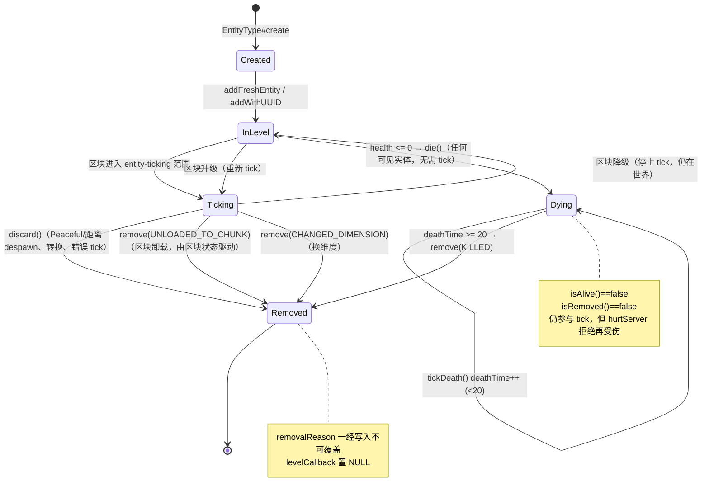
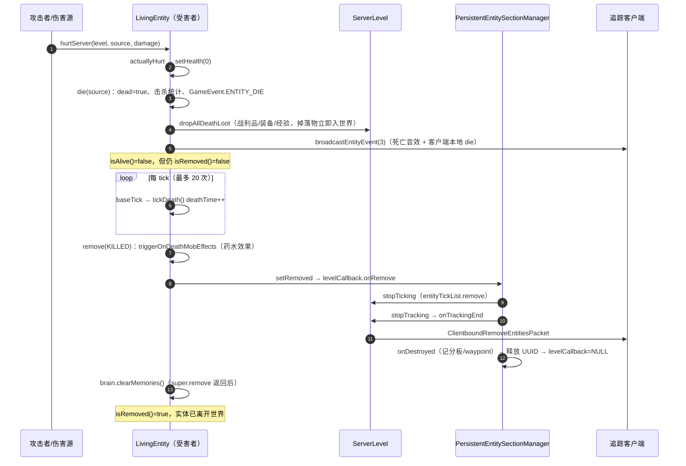

# 原版 Mob 生命周期与死亡流程调研

> 调研对象：`repo/minecraft-source-1.26`（反编译源码，对应项目使用的 MC 26.1）。
> 结论对 1.20.1 同样成立（`repo/minecraft-source-1.20.1-java` 的 `deathTime`/20 tick 移除结构一致），
> 但 1.21+ 把掉落相关方法重构成了 `dropAllDeathLoot` 一套，本文以 1.26 为准。

## 1. 结论速览

原版 Mob 的"死亡"不是一件事，而是**三个正交状态 + 一条移除通道**：

| 概念 | 字段 / 判定 | 语义 |
|---|---|---|
| 活着 | `LivingEntity#isAlive()` = `!isRemoved() && getHealth() > 0` | 血量与移除状态**同时**成立才算活着 |
| 濒死 | `isDeadOrDying()` = `getHealth() <= 0` | 血量归零，但实体仍完整留在世界里，还能被 tick |
| 已死亡（逻辑） | `LivingEntity#dead` 布尔 | `die()` 只执行一次的保护锁，与血量无关 |
| 已移除 | `isRemoved()` = `removalReason != null` | 唯一"离开世界"的入口，五种原因 |

关键时序：

1. **血量归零的那一 tick**：`die()` 执行完毕 → 掉落物/经验已生成、`isAlive()` 立刻变 `false`，
   但实体**仍在世界中**，`isRemoved()` 仍为 `false`。
2. **其后 20 tick**：每 tick 走 `tickDeath()` 累加 `deathTime`，播放死亡动画。
3. **第 20 tick**：`remove(RemovalReason.KILLED)` → 实体从 section/追踪/ tick 列表中摘除，
   `isRemoved()` 变 `true`，掉落与死亡效果之外的收尾（药水效果、Brain 记忆、UUID 释放）在这一步完成。

所以：**"死亡"（血量为 0）比"消失"（移除）早 20 tick**，两者之间的窗口里实体依然参与 tick。
对 GymCraft 这类以 `isAlive()` 判终态的环境，`terminated=true` 出现在死亡当 tick，而不是移除时。

## 2. 源码地图

| 关注点 | 文件 | 关键行 |
|---|---|---|
| 实体基础生命周期、移除原因 | `world/entity/Entity.java` | `kill` 404、`discard` 409、`remove` 429、`tick` 506、`baseTick` 510、`isAlive` 2150、`setRemoved` 3862、`RemovalReason` 4162 |
| 受伤、死亡、掉落 | `world/entity/LivingEntity.java` | `baseTick` 407、`tickDeath` 565、`remove` 713、`isDeadOrDying` 1188、`hurtServer` 1193、`die` 1473、`dropAllDeathLoot` 1528、`handleEntityEvent` 2079 |
| Mob 的 AI 与自然消失 | `world/entity/Mob.java` | `tick` 347、`aiStep` 476、`checkDespawn` 683、`serverAiStep` 711、`dropCustomDeathLoot` 895 |
| 服务端 tick 编排 | `server/level/ServerLevel.java` | 实体循环 429-457、`tickNonPassenger` 838、`addEntity` 1013、`EntityCallbacks` 1911 |
| 实体分区/追踪管理 | `world/level/entity/PersistentEntitySectionManager.java` | `Callback#onRemove` 456、`unloadEntity` 239 |
| 网络层移除 | `server/level/ChunkMap.java` 1182、`server/level/ServerEntity.java` 255 | `ClientboundRemoveEntitiesPacket` |
| 死亡附加效果 | `world/effect/OozingMobEffect.java`、`WeavingMobEffect.java`、`WindChargedMobEffect.java` | `onMobRemoved` |

## 3. 类层次与状态机

```
Entity                    基础：位置/移除原因/tick/存档
 └─ LivingEntity          生命/伤害/死亡动画/掉落/药水效果
     └─ Mob                AI（Goal/Navigation/Look/Move）、自然消失、装备掉落
         └─ PathfinderMob 寻路（GymCraft 的 PlayerSimEntity 继承它）
```



## 4. 创建与加入世界

1. `EntityType#create(level, reason)` 调工厂构造实例（`world/entity/EntityType.java:1492`）；
   带位置的 `create(ServerLevel, ..., spawnPos, reason, ...)` 额外做 `snapTo` 并调用
   `Mob#finalizeSpawn`（`EntityType.java:1373-1400`），NeoForge 在 spawn 被取消时直接 `mob.discard()`。
2. `ServerLevel#addFreshEntity` → `addEntity`（`ServerLevel.java:1013`）：
   - 已 `isRemoved()` 的实体拒绝加入并打 warn；
   - `PersistentEntitySectionManager#addNewEntity` 发 `EntityJoinLevelEvent`（可取消），
     登记 UUID（重复 UUID 直接拒绝）、按 `SectionPos` 放进 section、安装 `EntityInLevelCallback`；
   - 成功后才调 `entity.onAddedToLevel()`（NeoForge 的 `isAddedToLevel` 标记）。
3. 可见性/可 tick 由 section 的 `Visibility` 决定：
   `TICKING` 才进 `entityTickList`（`onTickingStart`），`TRACKED` 才进可见集合（`onTrackingStart`）。
   `Entity#isAlwaysTicking()` 可强制 tick（默认 `false`）。

## 5. 每 tick 执行链

`ServerLevel#tick` 的实体段（`ServerLevel.java:421-461`）：

```java
this.entityTickList.forEach(entity -> {
    if (!entity.isRemoved()) {
        if (!tickRateManager.isEntityFrozen(entity)) {
            entity.checkDespawn();                       // ① 先判自然消失
            if (entity instanceof ServerPlayer || 区块在 entity-ticking 范围) {
                ... stopRiding 处理 ...
                if (!entity.isRemoved() && !(entity instanceof PartEntity))
                    this.guardEntityTick(this::tickNonPassenger, entity);   // ② 真正 tick
            }
        }
    }
});
...
this.entityManager.tick();                               // ③ 处理待加载区块实体
```

要点：

- **`checkDespawn` 在 tick 之前**，被 despawn 掉的实体当 tick 就不会再 tick（`isRemoved()` 复查）。
- `guardEntityTick` 捕获异常：NeoForge 配置 `removeErroringEntities` 为真时直接 `entity.discard()`
  （`Level.java:540-544`），这是"实体莫名消失"的常见来源之一。
- `tickNonPassenger`（`ServerLevel.java:838`）先 `setOldPosAndRot()`、`tickCount++`，
  再触发 `EntityTickEvent.Pre/Post`，中间调 `entity.tick()`；乘客走 `tickPassenger`/`rideTick`。

单实体 tick 的调用栈：

```
tickNonPassenger（ServerLevel）
 └─ Mob#tick
     └─ LivingEntity#tick
         ├─ super.tick() → Entity#tick → LivingEntity#baseTick（虚分派）
         │                               └─ Entity#baseTick   火焰/传送门/掉出世界/拴绳
         │      （LivingEntity#baseTick 自身：窒息/墙内/溺水/无敌帧递减/死亡动画推进/仇恨记忆衰减/药水效果）
         ├─ 使用物品、装备变化检测、战斗追踪
         └─ aiStep()（仅当 !isRemoved()）
             └─ Mob#aiStep（白天燃烧、拾取物品）→ super.aiStep()
                 └─ LivingEntity#aiStep   重力/跳跃/移动/冰冻/药水位移
                     └─ serverAiStep()（Mob 实现）sensing → targetSelector → goalSelector
                                                  → navigation → customServerAiStep → move/look/jump control
```

两个容易忽略的细节：

- 死亡动画推进挂在 `LivingEntity#baseTick` 里，**每 tick 都会检查**（不依赖 AI 是否运行）
  （`LivingEntity.java:472`）：`if (isDeadOrDying() && level.shouldTickDeath(this)) tickDeath();`。
- `LivingEntity#tick` 只在 `!isRemoved()` 时调 `aiStep()`；**濒死（血量 0、未移除）仍会完整跑 AI**，
  只是 `isAlive()` 为 false，各 Goal 是否行动取决于它自己有没有做存活检查。

## 6. 受伤 → 死亡（核心流程）

### 6.1 `hurtServer` 的判定顺序

`LivingEntity#hurtServer`（`LivingEntity.java:1193`）是服务端唯一伤害入口，顺序如下：

1. `isInvulnerableTo` → 直接 `false`；
2. **`isDeadOrDying()` → 直接 `false`**（尸体不可再受伤，这是"死亡后伤害无效"的根因）；
3. 火焰伤害 + 抗火 → `false`；
4. NeoForge `DamageContainer` 入栈、`onEntityIncomingDamage` 可取消；
5. 清 `noActionTime`、取 `getUseItem()` 做盾牌格挡（`applyItemBlocking`）、冰冻/头盔额外结算；
6. 无敌帧逻辑：`invulnerableTime > 10` 且伤害不大于 `lastHurt` → 直接返回 `false`；
   否则只结算增量并保留 `lastHurt`；
7. `actuallyHurt`（`LivingEntity.java:1968`）：护甲减伤 → 魔法减伤 → 吸收（黄心）→
   `setHealth(health - damage)` → `CombatTracker.recordDamage` → `GameEvent.ENTITY_DAMAGE`；
8. 击退、`markHurt`、`broadcastDamageEvent`；
9. **死亡判定**：`if (isDeadOrDying()) { if (!checkTotemDeathProtection(source)) { 死亡音效; die(source); } }`
   —— 图腾优先，图腾生效则 `setHealth(1)` 并广播 `EntityEvent.PROTECTED_FROM_DEATH(35)`；
10. 记录 `lastDamageSource`、触发药水 `onMobHurt`、玩家成就/统计。

### 6.2 `die()` 内部做了什么

`LivingEntity#die`（`LivingEntity.java:1473`）：

```java
public void die(DamageSource source) {
    if (CommonHooks.onLivingDeath(this, source)) return;        // NeoForge 可整体取消
    if (!this.isRemoved() && !this.dead) {                      // 只执行一次
        Entity sourceEntity = source.getEntity();
        LivingEntity killer = this.getKillCredit();             // lastHurtByPlayer > lastHurtByMob
        if (killer != null) killer.awardKillScore(this, source);
        if (this.isSleeping()) this.stopSleeping();
        this.stopUsingItem();
        ... 自定义名字写日志 ...
        this.dead = true;
        this.getCombatTracker().recheckStatus();                // 生成死亡消息
        if (this.level() instanceof ServerLevel serverLevel) {
            if (sourceEntity == null || sourceEntity.killedEntity(serverLevel, this, source)) {
                this.gameEvent(GameEvent.ENTITY_DIE);           // 监守者/幽匿感测体
                this.dropAllDeathLoot(serverLevel, source);     // 掉落 + 经验
                this.createWitherRose(killer);                  // 凋灵杀手 → 玫瑰
            }
            this.level().broadcastEntityEvent(this, (byte)3);   // 客户端死亡动画
        }
        this.setPose(Pose.DYING);
    }
}
```

值得注意的几处"可被外部改写"：

- `CommonHooks.onLivingDeath` 可以**整体否决**死亡（实体不会进入 `dead`）；
- `killer.killedEntity(...)` 返回 `false` 时**跳过掉落与 ENTITY_DIE 事件**。
  典型实现：`Player#killedEntity` 记 `Stats.ENTITY_KILLED`（`Player.java:1533`）；
  `Zombie#killedEntity` 在普通/困难难度把村民转成僵尸村民并返回 `false`（`Zombie.java:428`）；
- 玩家击杀才会进入 `awardStat`/成就链，Mob 击杀只走默认 `true`。

### 6.3 掉落：三个独立来源

`LivingEntity#dropAllDeathLoot`（`LivingEntity.java:1528`）：

```java
this.captureDrops(new ArrayList<>());                 // 之后 spawnAtLocation 只收集，不直接入世界
boolean playerKilled = this.lastHurtByPlayerMemoryTime > 0;
if (this.shouldDropLoot(level)) {                     // !isBaby() && GameRules.MOB_DROPS
    this.dropFromLootTable(level, source, playerKilled);
    this.dropCustomDeathLoot(level, source, playerKilled);
}
this.dropEquipment(level);
this.dropExperience(level, source.getEntity());
Collection<ItemEntity> drops = captureDrops(null);
if (!CommonHooks.onLivingDrops(this, source, drops, playerKilled))   // NeoForge LivingDropsEvent
    drops.forEach(e -> level().addFreshEntity(e));    // 统一入世界
```

| 来源 | 方法 | 触发条件 |
|---|---|---|
| 战利品表 | `dropFromLootTable` | `shouldDropLoot`（非幼年 + `MOB_DROPS`）；表来自 `EntityType#getDefaultLootTable` 或 `Mob#lootTable`（用后清空） |
| 自定义掉落 | `dropCustomDeathLoot` | 同上；`Mob` 的实现是**装备槽**：`dropChances > 0` 且 `(killedByPlayer \|\| preserved)` 且随机命中 |
| 经验 | `dropExperience` | `lastHurtByPlayerMemoryTime > 0`（100 tick 内被玩家打过）且 `shouldDropExperience()`（默认非幼年）且 `MOB_DROPS`；`isAlwaysExperienceDropper()` 可无视 |

补充：

- 装备掉落的耐久会被随机损耗（`Mob.java:911-915`），`PREVENT_EQUIPMENT_DROP` 附魔组件可整体阻止；
- `lastHurtByPlayerMemoryTime` 每 tick 递减，`lastHurtByMob` 100 tick 后清空（`LivingEntity.java:476-493`）
  —— 这就是"打了怪但隔太久才死，不掉经验/不算玩家击杀"的原因；
- 掉落物在 `die()` 内、实体被移除**之前**就已生成，且生成时带 `setDefaultPickUpDelay()`；
- `captureDrops` 机制使 NeoForge 的 `LivingDropsEvent` 能增删改掉落物。

### 6.4 客户端表现

- `broadcastEntityEvent(this, (byte)3)`：客户端 `LivingEntity#handleEntityEvent` 的 `case 3`
  （`LivingEntity.java:2084`）播死亡音效，并对**非玩家**执行 `setHealth(0)` + `die(generic)`
  —— 客户端自己也会跑一遍 `die()`，但 `level` 不是 `ServerLevel`，所以不掉落；
- `deathTime` 由客户端 `baseTick` 推进（`ClientLevel#shouldTickDeath` 按模拟距离判定，
  `ClientLevel.java:355`），渲染层据此做倒地动画；
- 第 20 tick 的 `broadcastEntityEvent(this, (byte)60)` 是 `EntityEvent.POOF`，客户端冒白烟。

### 6.5 端到端时序



## 7. 濒死 20 tick：`tickDeath`

```java
protected void tickDeath() {
    this.deathTime++;
    if (this.deathTime >= 20 && !this.level().isClientSide() && !this.isRemoved()) {
        this.level().broadcastEntityEvent(this, (byte)60);
        this.remove(Entity.RemovalReason.KILLED);
    }
}
```

`LivingEntity.java:565`。要点：

- 20 tick 是**硬编码**的动画时长，不是"尸体存活时间"配置项；
- 服务端 `Level#shouldTickDeath` 恒 `true`（`Level.java:550`），客户端按距离；
- 这 20 tick 内：
  - `isAlive() == false`、`isDeadOrDying() == true`、`isRemoved() == false`；
  - `hurtServer` 一律拒绝（`isDeadOrDying` 早退）；
  - `aiStep`/`serverAiStep` 仍会跑（`LivingEntity.java:2802` 只挡 `isRemoved()`），
    所以尸体仍会受重力、被推动、甚至继续执行未检查存活的 Goal；
  - 实体仍占着 UUID、仍在 `entityTickList`、仍对客户端可见（用于渲染倒地动画）。

推论：**死亡动画只在实体被 tick 时推进**。若实体所在区块退出了 entity-ticking 范围
（`ServerLevel.java:437-438` 的距离判定），`baseTick` 不再执行，`deathTime` 就停住，
尸体会一直留在世界里直到区块重新进入 ticking 范围——这也是"受控实体必须强加载"的另一个理由
（GymCraft 由 `EnvChunkGuard` 用 ticking 级票据保证）。

## 8. 移除：`remove` / `setRemoved`

### 8.1 五种 `RemovalReason`

`Entity.RemovalReason`（`Entity.java:4162`）：

| 值 | `shouldDestroy` | `shouldSave` | 典型来源 |
|---|---|---|---|
| `KILLED` | true | false | `tickDeath` 满 20 tick、`/kill`、`Entity#kill` |
| `DISCARDED` | true | false | `discard()`：despawn、Peaceful 清场、转换、reset 替换、错误 tick |
| `UNLOADED_TO_CHUNK` | false | **true** | 区块卸载（`PersistentEntitySectionManager#unloadEntity`） |
| `UNLOADED_WITH_PLAYER` | false | false | 玩家载具/末影珍珠随玩家卸载 |
| `CHANGED_DIMENSION` | false | false | 换维度（`removeAfterChangingDimensions`） |

`shouldDestroy` 决定是否触发 `onDestroyed` 回调（记分板清理等），`shouldSave` 决定 `shouldBeSaved()`
——**只有区块卸载的实体会被写回存档**。

### 8.2 `setRemoved` 的执行顺序

```java
public final void setRemoved(Entity.RemovalReason reason) {
    if (this.removalReason == null) this.removalReason = reason;   // 只认第一次
    if (this.removalReason.shouldDestroy()) this.stopRiding();
    this.getPassengers().forEach(Entity::stopRiding);              // 乘客全部下车
    this.levelCallback.onRemove(reason);                           // 从 section/追踪/tick 摘除
    this.onRemoval(reason);                                        // 子类收尾
}
```

`Entity.java:3862`。注意它是 `final`：**模组只能覆盖 `remove` 或 `onRemoval`，不能改这段编排**。
`removalReason` 一经写入不会被后续 `remove` 覆盖，但第二次调用仍会走一遍
`levelCallback.onRemove`（此时回调已被置为 `NULL`，空实现）与 `onRemoval`。

### 8.3 `LivingEntity` 的覆盖

```java
public void remove(Entity.RemovalReason reason) {
    if ((reason == KILLED || reason == DISCARDED) && level instanceof ServerLevel level)
        this.triggerOnDeathMobEffects(level, reason);   // 逐个 effect.onMobRemoved，然后清空
    super.remove(reason);
    this.brain.clearMemories();                         // 移除完成后清 Brain 记忆
}
```

`LivingEntity.java:713`。三个细节：

1. **只有 `KILLED`/`DISCARDED` 才触发药水移除效果**，区块卸载/换维度不触发；
2. `triggerOnDeathMobEffects` 把 reason 透传给每个效果，效果自己决定是否响应
   （例如 `OozingMobEffect`/`WeavingMobEffect`/`WindChargedMobEffect` 都只认 `KILLED`，
   所以 `discard()` 不会生成史莱姆/蜘蛛网/风爆）；
3. `brain.clearMemories()` 在 `super.remove` **之后**执行，所以 `onRemoval` 阶段还能读到记忆；
   但移除完成后记忆即丢失——GymCraft 里 Warden 的 `DIG_COOLDOWN` 记忆不随 NBT 序列化，
   每次 reset 必须重新注入，正是这条链路的直接后果。

### 8.4 实体管理器摘除（`PersistentEntitySectionManager.Callback#onRemove`）

`PersistentEntitySectionManager.java:456-479`：

1. 从当前 `EntitySection` 移除（失败打 warn），必要时删空 section；
2. `status.isTicking()` → `stopTicking` → `ServerLevel.EntityCallbacks#onTickingEnd`
   → `entityTickList.remove(entity)`；
3. `status.isAccessible()` → `stopTracking` → `onTrackingEnd`（见 8.5）；
4. `reason.shouldDestroy()` → `onDestroyed`（记分板 `entityRemoved`、waypoint 取消）；
5. `knownUuids.remove(uuid)` —— UUID 此时才可被复用；
6. `entity.setLevelCallback(NULL)`，彻底断开与世界的联系。

### 8.5 `ServerLevel.EntityCallbacks`（`ServerLevel.java:1911-2009`）

`onTrackingEnd` 是"实体离开世界"时最全的一个钩子，按序做：

- `chunkSource.removeEntity(entity)` → `ChunkMap#removeEntity`（`ChunkMap.java:1182`）
  → `TrackedEntity#broadcastRemoved` → `ServerEntity#removePairing`
  → 给每个追踪者发 `ClientboundRemoveEntitiesPacket`（`ServerEntity.java:255`）；
- 玩家：从 `players` 移除、waypoint 管理器移除；
- `Mob`：从 `navigatingMobs` 移除（寻路迭代安全集合）；
- 多部件实体（末影龙）：清理 `dragonParts`；
- `entity.updateDynamicGameEventListener(remove)`、`debugSynchronizers.dropEntity`；
- `entity.onRemovedFromLevel()`（NeoForge `isAddedToLevel=false`）；
- 发 `EntityLeaveLevelEvent`。

### 8.6 存档视角

`Entity#shouldBeSaved()`（`Entity.java:3886`）：`removalReason` 存在且 `!shouldSave()` → 不存；
是乘客 → 不存（由载具根实体代表）；唯一玩家乘客 → 不存。
所以**死亡实体不会被写回存档**，区块卸载的实体会被写回并在下次加载时重建。

### 8.7 移除之后的引用与回收

**`remove` 不"释放"对象，Java 也没有这个动作。** `Entity` 没有 `close()`/`dispose()`/`finalize`/`Cleaner`
（`Entity.java`、`LivingEntity.java` 中均无终结器或弱引用），`setRemoved` 只做三件事：置 `removalReason`、
把实体从世界的各种索引里摘掉、回调子类。对象之后**能否被回收，只取决于还有没有强引用指向它**。

#### 世界侧引用：同步切断

| 持有者 | 摘除点 | 时机 |
|---|---|---|
| `EntitySection`（分区） | `Callback#onRemove` 首行 | `setRemoved` 内 |
| `EntityLookup.byId` / `byUuid`（可见实体索引） | `stopTracking` → `visibleEntityStorage.remove` | 同上 |
| `entityTickList` | `stopTicking` → `onTickingEnd` | 同上 |
| `ChunkMap.entityMap` / `ServerEntity` | `chunkSource.removeEntity` | 同上（在 `onTrackingEnd` 内） |
| `knownUuids`（UUID 占用表） | `Callback#onRemove` | 同上 |
| `ServerLevel.navigatingMobs` / `dragonParts` / `debugSynchronizers` | `onTrackingEnd` | 同上 |
| 记分板队伍与目标、waypoint | `onDestroyed` / `onRemoval` | 同上 |
| `levelCallback` | 末尾置 `EntityInLevelCallback.NULL` | 同上 |

这套切断是**同步完成**的，所以 `setRemoved` 返回后立刻：

- `level.getEntity(uuid)`、`getEntityInAnyDimension`、`getEntities(...)` 都查不到它；
- `entityTickList.contains(entity)` 为 `false`，不会再收到 `EntityTickEvent`；
- 但**只要还有别处的强引用**（见下），Java 对象本身仍在堆上，`isRemoved()` 为 `true` 只是逻辑标记。

唯一的短暂残留：`EntityTickList#remove`（`world/level/entity/EntityTickList.java:35`）在迭代期间会复制并交换
`active`/`passive`，当前这轮迭代仍在旧表上遍历，所以被移除的实体会被旧表多持有**当前这一轮 tick**，
下一轮 swap 时释放。不是泄漏。

#### 跨实体引用：惰性失效

原版**不会**在移除时主动清空其他实体对自己的引用，而是靠 `isRemoved()`/`isAlive()` 在下一次访问时判废。
这些引用才决定对象实际能活多久：

| 引用方 | 字段 | 释放时机 |
|---|---|---|
| 其他 Mob 的攻击目标 | `Mob.target`（`Mob.java:131`，**强引用**） | `TargetGoal.stop()` / `MeleeAttackGoal.stop()` 调 `setTarget(null)`；`canContinueToUse` 经 `canBeSeenByAnyone()`（含 `isAlive()`，`LivingEntity.java:958`）判废后 stop，通常下一次目标判定（1–2 tick）内 |
| 其他生物的最后攻击对象 | `LivingEntity.lastHurtMob`（`LivingEntity.java:249`，**强引用**） | 持有者下一次 `baseTick` 发现 `!isAlive()` 即置空（`LivingEntity.java:482`） |
| 仇恨/击杀记忆 | `lastHurtByMob` / `lastHurtByPlayer`（`EntityReference`，`LivingEntity.java:234/247`） | `EntityReference` 内部是 `Either<UUID, Entity>`：**命中时是强引用**，只有下次 `getEntity` 发现 `isRemoved()` 才降级为 UUID；仇恨记忆本身 100 tick 后清空 |
| 攻击者的战斗记录 | `CombatTracker.entries` → `CombatEntry.source` → `DamageSource.causingEntity/directEntity`（**强引用**） | 攻击者每 20 tick `recheckStatus()`；`tickCount - lastDamageTime > 300`（约 15 s）或攻击者死亡才 `entries.clear()`（`CombatTracker.java:150-161`） |
| 其他 Mob 的 Brain 记忆 | `MemoryModuleType.ATTACK_TARGET` 等直接存 `LivingEntity` | 记忆被覆盖/擦除，或该 Mob 自己被移除时 `brain.clearMemories()` |
| Goal 内部缓存 | `TargetGoal.targetMob`、`NearestAttackableTargetGoal.target` | `stop()` 时清空 |
| 拴绳 | `LeashData.leashHolder` 是**指向外**的强引用 | 不构成对已移除实体的持有；栅栏结只按需查询世界，没有反向列表 |

结论：**纯原版场景下，被移除的 Mob 通常在 1 tick 内就不再被 AI 引用，最多被攻击者的战斗记录拖到约 15 秒**。
但如果持有者自己不再 tick（区块卸载、实体冻结、逻辑停摆），这些引用会一直留着，对象也就一直不可回收。
`EntityReference` 是最容易误判的：名字像弱引用，实际是强引用直到被判废。

#### 模组侧：真正决定"会不会回收"的往往是自己的静态表

GymCraft 就是典型：`EnvManager.ENVS_BY_ENTITY`（`ConcurrentHashMap<UUID, McEnv>`）→ `AbstractMcEnv`
→ `AgentRuntime.mob`（`AgentRuntime.java:44`）构成**强引用链**。因此：

- Agent 死亡并被 `KILLED` 移除后，**只要环境还开着，这个 Mob 对象就不可回收**——这是有意的，
  环境必须还能响应 `step` 并返回 `terminated`；
- `EnvManager.close(uuid)` 摘掉静态表项、`AbstractMcEnv#close` 反注册事件监听并释放区块票之后，
  整条链才整体变成垃圾；
- `VisualizationService.SUBSCRIPTIONS`（静态 `Map<UUID, Subscription>`）持有 `McEnv`，
  有玩家观察时会额外延长生命周期，直到取消订阅/玩家离线/环境关闭；
- 组件会话状态挂在 Mob 的 NeoForge attachment 上（`mob.setData(...)`），是**自引用**，
  随对象一起回收；若改成"静态 `Map<UUID, 会话>`"就会立刻变成泄漏点。

实践建议：

1. 需要"移除时清理"的东西（缓存、注册表项、会话、票据）挂在 `Entity#onRemoval` 或
   NeoForge `EntityLeaveLevelEvent` 上，不要指望 finalize/GC；
2. 静态表里不要长期缓存 `Entity` 对象，要缓存就存 UUID，用时经 `level.getEntity(uuid)` 解析；
3. 需要弱引用语义时别拿 `EntityReference` 当 `WeakReference` 用（见上），真正的弱引用要自己用
   `WeakReference`/`WeakHashMap`；注意 `Entity#equals/hashCode` 基于自增 `id`（`Entity.java:420-427`）；
4. `revive()`（NeoForge，`Entity.java:3959`）只清 `removalReason`，**不会**把实体重新登记进
   section/tick/追踪，想复用必须重新 `addFreshEntity`。

## 9. 其他"消失"路径（都不等于死亡）

| 路径 | 入口 | 结果 |
|---|---|---|
| 自然消失 | `Mob#checkDespawn`（`Mob.java:683`） | `discard()` → `DISCARDED`，无掉落、无死亡动画 |
| Peaceful 清场 | 同上首分支：`difficulty == PEACEFUL && !type.isAllowedInPeaceful()` | 同上 |
| 区块卸载 | `PersistentEntitySectionManager#unloadEntity` | `UNLOADED_TO_CHUNK`，`shouldSave`，下次加载复活 |
| 换维度 | `Entity#removeAfterChangingDimensions` | `CHANGED_DIMENSION`，新维度以同 UUID 新实例加入 |
| 形态转换 | `Mob#convertTo`（`Mob.java:1238`） | 新实体入世界，旧实体按 `ConversionType` 决定是否 `discard()` |
| tick 抛异常 | `Level#guardEntityTick` + NeoForge 配置 | `discard()` |
| 指令/测试 | `/kill` → `Entity#kill(level)`；`GameTestHelper#kill` | **走正常死亡流程**（`LivingEntity#kill` = `hurtServer(genericKill, Float.MAX_VALUE)`） |
| 手动 | `entity.discard()` | 立即 `DISCARDED` |

`checkDespawn` 的完整判定（无 NeoForge 事件取消时）：

```java
if (difficulty == PEACEFUL && !type.isAllowedInPeaceful()) discard();
else if (!isPersistenceRequired() && !requiresCustomPersistence()) {
    player = level.getNearestPlayer(this, -1.0);
    if (player != null) {
        if (distSqr > despawnDistance² && removeWhenFarAway(distSqr)) discard();       // 128 格
        if (noActionTime > 600 && random.nextInt(800) == 0
            && distSqr > 32² && removeWhenFarAway(distSqr)) discard();                 // 随机清场
        else if (distSqr < 32²) noActionTime = 0;
    }
}
```

- `despawnDistance` 按 `MobCategory`：绝大多数 128，`WATER_AMBIENT` 64（`MobCategory.java`）；
- `noDespawnDistance` 恒 32；
- `requiresCustomPersistence()` 只覆盖"乘客 / 被拴"（`Mob.java:678`）；
- **没有玩家时（`getNearestPlayer` 返回 null）距离消失不会触发**，只剩 Peaceful 分支；
- `isPersistenceRequired()` 需显式 `setPersistenceRequired()`（或 NBT `PersistenceRequired`）。

## 10. 死亡副作用发生时机矩阵

| 副作用 | 发生阶段 | 备注 |
|---|---|---|
| 死亡音效（服务端） | `hurtServer` 的死亡分支 | `makeSound(getDeathSound())` |
| 死亡音效（客户端） | `EntityEvent.DEATH(3)` | 客户端本地再播一次 |
| 击杀统计/成就 | `die()` → `killer.awardKillScore` / `killedEntity` | 仅玩家击杀者 |
| 战利品表、装备、经验 | `die()` → `dropAllDeathLoot` | 掉落物在实体移除前入世界 |
| 凋灵玫瑰 | `die()` → `createWitherRose` | 击杀者为凋灵 |
| 幽匿/监守者感知 | `die()` → `gameEvent(ENTITY_DIE)` | 可被 `killedEntity=false` 跳过 |
| 死亡动画 | 之后 20 tick `tickDeath` | `deathTime` 0→20 |
| 药水移除效果 | `remove()` → `triggerOnDeathMobEffects` | 仅 `KILLED`/`DISCARDED`，效果自行判 reason |
| Brain 记忆清空 | `remove()` 末尾 | `brain.clearMemories()` |
| 追踪/网络移除 | `setRemoved` → `levelCallback.onRemove` | `ClientboundRemoveEntitiesPacket` |
| 记分板/waypoint/UUID 释放 | 同上 | `shouldDestroy` 决定 `onDestroyed` |
| 存档剔除 | 存档时 `shouldBeSaved` | `KILLED`/`DISCARDED` 不落盘 |

## 11. 易错点

1. **`isAlive()` ≠ `!isRemoved()`**：`LivingEntity` 覆盖为 `!isRemoved() && health > 0`；
   `Entity` 版本才是 `!isRemoved()`。判"死了没"用 `isAlive()`/`isDeadOrDying()`，判"还在不在"用 `isRemoved()`。
2. **死亡后还有 20 tick 的"活尸体"**：这段时间 `isRemoved()==false`、`entityTickList` 仍含它、
   AI 仍 tick、但伤害被拒绝。任何"死亡即视为消失"的假设都会在这 20 tick 里出错。
3. **`discard()` 不是 `kill()`**：`discard()` 不触发掉落/死亡音效/死亡动画/`ENTITY_DIE`，
   但仍会触发 `onMobRemoved(DISCARDED)`（效果多半判 `KILLED` 而静默）。
4. **`removalReason` 只认第一次**，`setRemoved` 是 `final`；想"复活"只能用 NeoForge 的
   `Entity#revive()`（清空 reason），且不会自动重新加回 section/tick 列表。
5. **`die()` 只跑一次**（`dead` 锁 + `isRemoved` 检查），重复 `hurtServer` 在血量 0 时直接返回 `false`。
6. **掉落依赖 100 tick 的玩家击杀记忆**（`lastHurtByPlayerMemoryTime`）：远程/延迟击杀容易丢经验与装备掉落。
7. **装备掉落需要玩家击杀或 `preserved`**，且受 `dropChances` 与耐久损耗影响；幼年生物不掉战利品。
8. **`UNLOADED_TO_CHUNK` 走的是 `setRemoved` 而非 `remove`**（`unloadEntity` 直接调 `setRemoved`），
   所以区块卸载**不会**触发 `LivingEntity#remove` 的药水效果清理——这是有意的（不是死亡）。
9. **Peaceful 会清掉 `isAllowedInPeaceful()==false` 的 Mob**，与距离、持久化标记无关；
   `EntityType.Builder` 的 `allowedInPeaceful` 默认 `true`，原版怪物类型显式设为 `false`。
10. **无玩家时不会因距离 despawn**，但 `noActionTime` 分支同样被 `player != null` 包住。
11. **死亡实体不会被存档**：`KILLED` 不 `shouldSave`，所以重启后不会"复活成尸体"。
12. **客户端也执行 `die()`**：调试时看到客户端 `die` 日志属正常，掉落只在服务端发生。
13. **`remove` 不等于内存释放**：世界侧引用同步切断，跨实体引用惰性失效（战斗记录最长约 15 s），
    模组自己的静态表可以无限期持有——详见 §8.7。
14. **`EntityReference` 不是弱引用**：命中实体时持有强引用，只有再次查询且发现 `isRemoved()` 才降级为 UUID。

## 12. 对 GymCraft 的映射

### 12.1 当前实现如何贴合原版语义

| GymCraft 位置 | 行为 | 与原版的关系 |
|---|---|---|
| `AbstractMcEnv#isTerminated`（`AbstractMcEnv.java:499`） | `return !this.mob().isAlive();` | 死亡**当 tick** 终止，不等 20 tick 移除；与 `LivingEntity#isAlive` 语义一致 |
| `AbstractActionComponentController#validateMobForAction` | 依次判 `isDeadOrDying` → `isRemoved` → `!isAlive` → 是否 `ServerLevel` | 覆盖"濒死未移除"与"已移除"两种窗口 |
| `AgentDeathGameTests` | 空闲死亡、动作中死亡、已移除实体三种路径 | 对应本文 §6/§7/§8 的三段状态 |
| `AgentRuntime#onServerTickPost`（`AgentRuntime.java:158-178`） | `entityPostObserved` 为 false 时兜底推进批次 | 实体被移除后不再有 `EntityTickEvent.Post`，靠 `ServerTickEvent.Post` 兜底——正是 §8.4 的直接后果 |
| `AgentMobLifecycle#replace` | 先 `clearAllItems`，再 `discard()` 旧实体 | `DISCARDED` 不触发战利品/死亡效果，物品被清空而非掉落（reset 语义） |
| `PlayerSimEntity#removeWhenFarAway` | 恒 `false` | 关闭距离消失；`MobCategory.MISC` 的 `allowedInPeaceful` 默认 `true`，Peaceful 也不会被清 |

### 12.2 值得注意的风险点

1. **挂载原版怪物做 Agent 时存在 despawn 风险**：GymCraft 未调用 `setPersistenceRequired()`，
   若世界里存在真实玩家且距离超过 128 格（或 `noActionTime > 600` 触发随机清场），
   Agent 会被 `checkDespawn` 直接 `discard()`——表现为"环境突然 agent 消失且无 terminated 之外的任何痕迹"。
   无头服务器（无玩家）不受距离分支影响，但仍受 Peaceful 分支影响。
2. **死亡当 tick 与移除之间做 reset**：`AgentMobLifecycle#replace` 会对"濒死但未移除"的旧实体
   `discard()`，跳过剩余死亡动画；由于 `clearAllItems` 先执行，旧实体不会掉落任何东西。
3. **判定终态请继续用 `isAlive()`**：若改成 `isRemoved()`，`terminated` 会晚 20 tick；
   而且在这 20 tick 内，`validateMobForAction` 里只有第一道 `isDeadOrDying` 分支能拦住动作
   （`isRemoved` 为 `false`，第三道 `!isAlive` 排在它之后，语义上重复但顺序无关紧要）。
4. **依赖 Brain 记忆的逻辑**（如 Warden 的 `DIG_COOLDOWN`）在实体移除后必然丢失，
   且 `brain.clearMemories()` 在 `onRemoval` 之后执行；reset 重建时必须重新注入（`IronGolemWardenEnv#repinWarden`）。
5. **需要"死亡即移除"时不要用 `discard()` 代替 `kill()`**：会丢掉战利品与 `ENTITY_DIE`
   游戏事件（幽匿/监守者感知）；反之需要"静默清理"时也不要用 `kill()`，否则会掉落一地物品。
6. **"已移除"≠"已回收"**：环境存活期间 `EnvManager → AbstractMcEnv → AgentRuntime.mob` 一直强引用着
   被移除的 Agent（这是环境能在死亡后继续响应 `step` 的前提）。排查内存问题时不要把 `isRemoved()`
   当作对象已释放的证据，要看 `EnvManager.close` 是否执行、`VisualizationService` 订阅是否残留。

## 13. 复现与验证建议

- 观察三段状态：对同一 Mob 连续执行
  `/data get entity @e[type=zombie,limit=1] Health`、`DeathTime`、`PersistenceRequired`，
  并在 `die()` 后逐 tick 观察 `DeathTime` 增长到 20；
- 验证"死亡不掉落"：`/kill` 与 `discard()` 对比同一装备配置的僵尸；
- 验证"玩家击杀记忆"：先 `/damage <目标> 1 by <玩家>` 打一下，等 >100 tick 再 `/kill`，观察是否掉经验；
- 验证 despawn：创造模式飞远 128 格以上（`MobCategory.MONSTER`），观察实体是否被 `DISCARDED`；
- GymCraft 侧：`AgentDeathGameTests` 已覆盖 `isDeadOrDying` / `isRemoved` / 动作中死亡三条路径，
  新增死亡相关行为时优先扩展该测试类。
